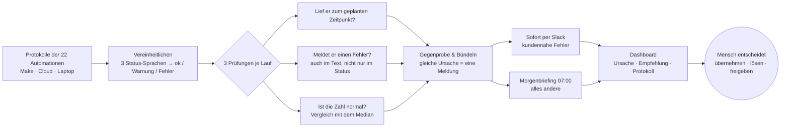

# Heartbeat · Wächter für 22 Automationen

**Das Problem:** Bei TradeLink laufen 22 Automationen und Agenten (Make-Szenarien, Claude-Routinen in der Cloud, geplante Aufgaben auf einem Laptop). Keine davon meldet sich, wenn sie nicht oder falsch läuft.

**Die Lösung:** Heartbeat prüft die Protokolle aller Läufe und sagt jedem Verantwortlichen jeden Morgen in Slack, was am Vortag nicht oder falsch gelaufen ist. Kundennahe Fehler meldet es sofort. Ein Klick führt ins Dashboard mit Ursache, Empfehlung und Rohprotokoll.

> Stand: funktionierendes MVP (Case-Session am 04.11.2026, technischer Freeze 15:00 Uhr). Slack ist ein Mockup, eine Anbindung an die echten Werkzeuge gibt es noch nicht.

---

## Direkt ansehen

> 🎬 **Am schnellsten:** [Demovideo (2:18 Min., MP4)](video/heartbeat_demo.mp4): ein echter Durchlauf durch das MVP, für Mitarbeitende, die Heartbeat noch nicht kennen.
> 📊 **Für Entscheider:** [Präsentation (PDF, 8 Folien)](praesentation/heartbeat_praesentation.pdf): Denkweise, Kriterien, Logik, Vorher/Nachher, Absicherung, Fazit.

Zwei Versionen desselben MVP, einmal mit den Ausgangsdaten und einmal mit dem Testlauf. Nebeneinander geöffnet lässt sich vergleichen, ob die neuen Daten die richtigen Ergebnisse liefern.

| | Version 1: Ausgangsdaten | Version 2: Testlauf 26.10. |
|---|---|---|
| **Daten** | Läufe 12.–25.10.2026 (403 Läufe) | zusätzlich die Läufe vom 26.10. (442 Läufe) |
| **Zeigt zuerst** | Briefing vom Mi 21.10. (der Tag mit den meisten Störungen) | Briefing vom Di 27.10. über den 26.10. |
| **Online, ohne Installation** | [Heartbeat bis 25.10.](https://claude.ai/artifact/CnsVpL8jFZXvqstir2ygk3) | [Heartbeat Testlauf 26.10.](https://claude.ai/artifact/Pkpyyp8toprAYnDvhPZfGt) |
| **Zum Herunterladen** (Doppelklick öffnet im Browser) | [heartbeat_bis_25-10.html](demo/heartbeat_bis_25-10.html) | [heartbeat_mit_26-10.html](demo/heartbeat_mit_26-10.html) |
| **Voll funktionsfähig lokal** | `./start_lokal.sh` → http://127.0.0.1:8765 | `./start_lokal.sh` → http://127.0.0.1:8766 |

In jeder Version: oben rechts **„Geführte Tour“** (8 Schritte), **„Slack-Mockup“** für die Nachrichten, **„Ansicht als“** für die Sicht der einzelnen Teams.
Online und im Download ist alles klickbar, Aktionen wie „Übernehmen“ werden dort aber nur angezeigt. Im lokalen Start werden sie gespeichert, und dort kann man auch eigene CSV- oder Excel-Protokolle einspielen.

*Hinweis zu den Online-Links: Sie sind privat, bis der Besitzer sie über „Share“ freigibt.*

### Stimmen die Ergebnisse? Vergleich vorher/nachher

Die Erwartung habe ich vor dem Testlauf von Hand aus der CSV vom 26.10. abgeleitet. Danach lief das Tool:

| Was in den Läufen vom 26.10. steckt | Von Hand erwartet | Version 2 meldet |
|---|---|---|
| A08 CRM-Kontaktabgleich: 871 statt ≈ 1.184 Kontakte | Einbruch | ✅ P2 „−26,4 % gegenüber dem Median“ |
| A17 Account-Anreicherung: 0 statt ≈ 38 Accounts | verdächtige Null | ✅ P2 „liefert 0 statt ≈ 38“ |
| A19 Build-Log fehlt, obwohl der Laptop lief | Ausfall (2. Woche in Folge) | ✅ P2 „fehlt zum 2. Mal in Folge“ |
| A01 MQL-Erinnerung lief um 08:30:02 und 08:30:44 | Doppellauf | ✅ P3 „doppelt gelaufen“ |
| A02 postet Ticket #48404 zum zweiten Mal (erstmals 15.10.) | Hinweis | ✅ Info im Dashboard |
| A09 Team-Report weiter bei 139 statt ≈ 165 | Störung bleibt offen | ✅ P2, 7. Lauf in Folge; Gegenprobe über A15 (211) und A10 (142) |
| Soll-Läufe am Montag | 32, davon 31 gestartet | ✅ „31 von 32“ |
| Alles andere (A04, A05, A07, A10, A12, A13, A15, A16, A18, A20, A21) | normal | ✅ keine Meldung |

Version 1 (Stand Ende 25.10.) zeigt dagegen nur die zwei offenen Altlasten (A09 und den Laptop-Ausfall, bei dem A17 und A19 noch nicht nachgeholt sind) sowie zwei Störungen, die wieder normal sind und auf Bestätigung warten (A02, A10). Details: [docs/testlauf-26-10.md](docs/testlauf-26-10.md).

---

## Die drei Antworten

### 1. Was meldet Heartbeat am Morgen des 27.10. über den 26.10.?

Um 7 Uhr bekommt jeder Verantwortliche („Owner“) in Slack ein gebündeltes Morgenbriefing zu seinen Automationen. Gibt es ein Problem oder Handlungsbedarf, führt ein Link direkt ins Dashboard. Dort stehen der Auszug aus dem Protokoll, der Verlauf der letzten Läufe, die vermutliche Ursache und eine Empfehlung. Kundennahe Fehler warten nicht bis 7 Uhr, sie gehen sofort raus.

**Konkret am 27.10.:** 31 von 32 geplanten Läufen sind gestartet. Neu sind vier Meldungen:
- **A19 Build-Log** fehlt zum 2. Mal in Folge, obwohl der Laptop lief (Owner: Daniel).
- **A17 Account-Anreicherung** liefert 0 statt ≈ 38 (Vertrieb).
- **A08 CRM-Kontaktabgleich** liegt 26 % unter dem Normalwert (Vertrieb, Marketing).
- **A01 MQL-Erinnerung** lief doppelt, Erinnerungen und CRM-Aufgaben sind also wohl zweimal angelegt (Vertrieb).

Weiter offen ist der Einbruch im **Team-Report A09** (−16 %). Die Gegenprobe zeigt: Der Deal-Bestand ist unverändert, es liegt wahrscheinlich am Filter des Reports. Zur Bestätigung offen sind die bereits behobenen Störungen der Vorwoche, darunter **20 Support-Tickets, die nie im Support-Kanal ankamen** und weiterhin nicht nachgetragen sind.

### 2. Wo würde es laufen, und wer bekommt die Meldung?

Die Meldung bekommt der Owner der jeweiligen Automation: im Morgenbriefing per Slack und ausführlich im Dashboard. Owner ist das Team aus der Spalte „genutzt von“, Automationen für alle Teams gehören Daniel.

Zusätzlich gilt:
- **Daniel (Chief of Staff)** sieht alle Automationen. Er bekommt eine Eskalation, wenn eine Sofortmeldung nach 60 Minuten niemand übernommen hat.
- **Die Geschäftsführung** bekommt ihre eigenen und alle kritischen Meldungen.
- **Fachbereiche** sehen nur ihre eigenen Automationen.

Laufen würde Heartbeat als kleiner Dienst in der Cloud. Bewusst nicht auf dem Laptop, der selbst ausfallen kann (wie am 16.10.). Heute läuft das MVP lokal oder als Online-Vorschau.

### 3. Übergabenotiz

> Hallo zusammen, beim Ausbau unserer Automationen und Agenten hat uns der Überblick gefehlt, ob alles läuft. Heartbeat prüft jeden Morgen die Protokolle aller 22 Automationen und sagt jedem Owner, was am Vortag nicht oder falsch gelaufen ist; kundennahe Fehler meldet es sofort. Es erkennt auch stille Fehler: Läufe, die „erfolgreich“ melden, aber nichts liefern, ungewöhnliche Zahlen, Doppelläufe und ausgefallene Läufe. Noch nicht abgedeckt sind die automatische Anbindung an Make, die Cloud-Routinen und den Laptop sowie echtes Slack; heute werden die Protokolle als Datei eingelesen. Als Nächstes würde ich die Automationen direkt anbinden, die Slack-App einrichten und statt Teams konkrete Personen als Owner hinterlegen. Mein Vorschlag: Wir testen Heartbeat eine Woche lang mit euch als Owner, und ich brauche euer ehrliches Feedback, was hilft und was stört.

---

## So funktioniert es (in einer Minute)



- **Drei Prüfungen statt Status-Glauben:** A02 meldete „success“, hat aber 20 Tickets nie gepostet. Der Fehler stand nur im Text.
- **Median statt Bauchgefühl:** Ein Wert ist auffällig, wenn er deutlich vom Median der letzten guten Läufe abweicht. Auffällige Werte fließen nicht in den Vergleich ein, damit sich ein Fehler nicht selbst zum Normalfall macht.
- **Priorität:** P1 kritisch bis P4 Hinweis. Kundennahes geht sofort raus (A02, A03, A07, A22), alles andere gebündelt am Morgen. Unbearbeitetes steht am nächsten Morgen erneut im Briefing.
- **Mensch in der Schleife:** Heartbeat ändert nie selbst etwas. Änderungen an einer Automation brauchen eine Freigabe.

Mehr dazu: [docs/betrieb.md](docs/betrieb.md).

## Für neue Nutzer

- [**Onboarding: in 3 Minuten startklar**](docs/onboarding.md): Was du bekommst, was du tust, was die Farben bedeuten.
- [**Demovideo**](video/heartbeat_demo.mp4): 2:18 Minuten, ohne Ton außer Musik, mit Einblendungen. Zeigt Briefing, Sofortmeldung, Dashboard, Übernehmen und die Logik.
- [**Drehbuch für ein eigenes Loom-Video**](docs/loom-drehbuch.md): falls jemand den Rundgang mit eigener Stimme aufnehmen möchte.
- [**Präsentation (PDF)**](praesentation/heartbeat_praesentation.pdf): 8 Folien für Daniel (Chief of Staff): Denkweise und Promptverlauf, Kriterien, Logik, Vorher (12.–25.10.) und Nachher (26.10.) mit Screenshots, Absicherung, Fazit mit Grenzen.

## Was liegt wo

| Ordner | Inhalt | Für wen |
|---|---|---|
| [`aufgabe/`](aufgabe/AUFGABE.md) | Die Original-Aufgabenstellung | alle |
| [`data/`](data/) | Die Eingangsdaten: 22 Automationen, Läufe 12.–25.10., Läufe 26.10. (anonymisiert) | alle |
| [`analyse/`](analyse/anomalien-analyse.md) | Voranalyse: welche Auffälligkeiten in den Daten stecken, vor dem Bau | Fachbereich, Prüfer |
| [`demo/`](demo/) | Die zwei Versionen zum Herunterladen, dazu das Skript, das sie aus dem MVP baut | alle |
| [`docs/`](docs/) | Onboarding, Video-Drehbuch, Betrieb, Testlauf 26.10. | Nutzer, Betrieb |
| [`praesentation/`](praesentation/heartbeat_praesentation.pdf) | Präsentation als PDF (8 Folien) | Chief of Staff |
| [`video/`](video/heartbeat_demo.mp4) | Demovideo (MP4, 2:18 Min.) | Mitarbeitende |
| [`src/heartbeat/`](src/heartbeat/) | Der MVP-Code (Python, nur Standardbibliothek). Die Oberflächen liegen unter `web/` | Technik |
| [`src/client/`](src/client/) | Kleines Meldeskript für den Laptop (vorbereitet, noch nicht eingesetzt) | Technik |
| [`tests/`](tests/) | Automatische Tests, darunter alle Befunde aus Analyse und Testlauf | Technik |

## Selbst starten (Technik)

Voraussetzung: Python 3.9 oder neuer, keine weiteren Pakete.

```bash
./start_lokal.sh                                   # beide Versionen nebeneinander (8765 / 8766)
cd src && python3 -m heartbeat serve               # nur die aktuelle Version auf 8765
cd src && python3 -m heartbeat briefing --day 2026-10-26 --user daniel   # Briefing im Terminal
cd src && python3 -m unittest discover -s ../tests # Tests
python3 demo/build_demo.py                         # Download-Versionen in demo/ neu bauen
```

## Grenzen des MVP

- Keine Anbindung an Make, Cloud-Routinen, Laptop oder Slack. Die Protokolle kommen heute als Datei.
- Owner sind Teams, keine Personen, weil die Daten keine Namen enthalten.
- Nach zwei Wochen Daten sind die Vergleichswerte für Wochenjobs noch dünn. Die Schwellen sollten nach vier Wochen nachjustiert werden.
- Ein Auslöser, der gar nicht erst ankommt (z. B. ein neues Ticket ohne Lauf), ist ohne zweite Datenquelle nicht erkennbar.
- Bekannte Schwäche aus dem Testlauf: Der Hinweis „zeitlich nah“ verknüpft montags um 08:00 Dinge, die nichts miteinander zu tun haben. Er ist als Hypothese markiert.
