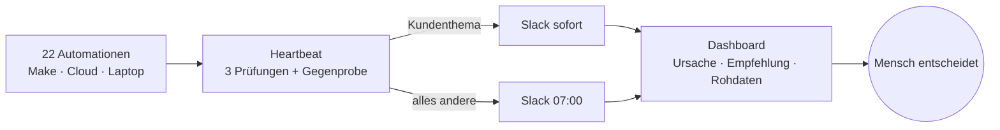

# Heartbeat · Wächter für 22 Automationen

**TradeLink Case** · Luca Ohm · 04.11.2026 · Stand: funktionierendes MVP (Code-Freeze 15:00)

> **In 30 Sekunden:** Bei TradeLink laufen 22 Automationen, und keine meldet sich, wenn sie ausfällt. **Heartbeat** prüft jeden Lauf und meldet jeden Morgen um 07:00 in Slack, was am Vortag schiefging, an das zuständige Team. Kundenthemen gehen sofort raus. Im Blindtest mit neuen Daten: **5 von 5 Auffälligkeiten erkannt, 0 Fehlalarme.**

## Hier prüfen

**Alles auf einer Seite, ohne Anmeldung:** https://lucaohm.github.io/TL_Case_04.12_Luca/

| | Was | Zeit |
|---|---|---|
| 📊 | [**Präsentation** (PDF, 7 Folien)](ergebnis/Praesentation_Heartbeat.pdf): Vorgehen, Leitplanken, Aufbau, Ergebnis | 5 Min. |
| 🎬 | [**Demo-Video für Mitarbeiter**](https://lucaohm.github.io/TL_Case_04.12_Luca/#video): So nutzt ein Team Heartbeat im Alltag ([Datei](ergebnis/Demo-Video_Mitarbeiter.mp4)) | 2 Min. |
| 🖱️ | **MVP ausprobieren:** [Stand bis 25.10.](https://lucaohm.github.io/TL_Case_04.12_Luca/ergebnis/MVP_bis_25-10.html) · [Testlauf 26.10.](https://lucaohm.github.io/TL_Case_04.12_Luca/ergebnis/MVP_mit_26-10.html) (oben rechts „Geführte Tour“) | frei |
| 📄 | [**Die drei Antworten**](#4-die-drei-antworten) auf die Fragen des Case, hier weiter unten | 2 Min. |

---

## 1. Das Problem

Die [Aufgabe](docs/aufgabe.md): Etwas bauen, das jeden Morgen sagt, was am Vortag nicht oder falsch gelaufen ist. Die [Analyse der zwei Wochen Protokoll](docs/analyse.md) zeigte, warum das nötig ist. Diese Fälle blieben unbemerkt:

- **20 Support-Tickets** kamen nie im Support-Kanal an, obwohl Make jedes Mal „success“ meldete.
- **6 Arbeitstage** lang bewertete der Deal-Score 0 statt 142 Deals. Dem Forecast fehlte seine Grundlage.
- **21 Laptop-Läufe** an zwei Tagen fielen aus oder kamen zu spät. Es gab keine Fehlermeldung, weil gar nichts lief.
- **31 Deals weniger** stehen seit dem 20.10. im Team-Report.

**Kernerkenntnis:** Die gefährlichsten Fehler melden Erfolg. Ein Blick auf den Status allein reicht nicht.

## 2. Vorgehen

[Daten analysiert](docs/analyse.md) → Logik gemeinsam festgelegt → MVP gebaut → [Blindtest mit den Läufen vom 26.10.](docs/testlauf-26-10.md) → Code-Freeze um 15:00 → Übergabe

## 3. Was gebaut wurde



- **Drei Prüfungen pro Lauf:** Lief er pünktlich? Gab es einen Fehler, auch im Text? Ist die Zahl normal, also nah am Median der letzten guten Läufe?
- **Richtige Person:** Jede Meldung geht an das zuständige Team. Daniel sieht alles und bekommt Eskalationen.
- **Mensch am Steuer:** Heartbeat schlägt nur vor und ändert nie selbst eine Automation.
- **Abgesichert:** Meldungen sind signiert, und es gibt immer einen Plan B: Fällt die KI aus, gilt das Regelwerk. Mehr dazu in [Betrieb und Sicherheit](docs/betrieb.md).

## 4. Die drei Antworten

### ① Was meldet Heartbeat am Morgen des 27.10.?

Am Mo 26.10. sind **31 von 32** geplanten Läufen gestartet. Das Briefing um 07:00 enthält diese Meldungen:

| Prio | Meldung | geht an |
|---|---|---|
| 🟠 P2 | **Build-Log** fehlt zum 2. Mal in Folge, obwohl der Laptop lief | Daniel |
| 🟠 P2 | **Account-Anreicherung** liefert 0 statt ≈ 38 | Vertrieb |
| 🟠 P2 | **CRM-Kontaktabgleich** liegt 26 % unter dem Normalwert | Vertrieb, Marketing |
| 🟡 P3 | **MQL-Erinnerung** lief doppelt | Vertrieb |
| ⚪ P4 | Ein Support-Ticket wurde erneut gepostet | Support |

Weiter offen ist der **Team-Report** (−16 %). Die Gegenprobe zeigt, dass es am Filter des Reports liegt, nicht am Deal-Bestand. Details: [Testlauf 26.10.](docs/testlauf-26-10.md)

### ② Wo läuft es, und wer bekommt die Meldung?

**Wo:** als kleiner Dienst in der Cloud, bewusst nicht auf dem Laptop, der selbst ausfallen kann. Heute läuft das MVP lokal und als Online-Vorschau.

| Wer | bekommt |
|---|---|
| **Owner-Team** (aus „genutzt von“) | Sofortmeldung bei Kundenthemen und das 07:00-Briefing zu den eigenen Automationen |
| **Daniel**, Chief of Staff | die Gesamtübersicht sowie eine Eskalation, wenn eine Sofortmeldung 60 Minuten liegen bleibt |
| **Geschäftsführung** | die eigenen und alle kritischen Meldungen |

### ③ Übergabenotiz

> Hallo zusammen, beim Ausbau unserer Automationen und Agenten hat uns der Überblick gefehlt, ob alles läuft. Heartbeat prüft jeden Morgen die Protokolle aller 22 Automationen und sagt jedem Owner, was am Vortag nicht oder falsch gelaufen ist; kundennahe Fehler meldet es sofort. Es erkennt auch stille Fehler: Läufe, die „erfolgreich“ melden, aber nichts liefern, ungewöhnliche Zahlen, Doppelläufe und ausgefallene Läufe. Noch nicht abgedeckt sind die automatische Anbindung an Make, die Cloud-Routinen und den Laptop sowie echtes Slack; heute werden die Protokolle als Datei eingelesen. Als Nächstes würde ich die Automationen direkt anbinden, die Slack-App einrichten und statt Teams konkrete Personen als Owner hinterlegen. Mein Vorschlag: Wir testen Heartbeat eine Woche lang mit euch als Owner, und ich brauche euer ehrliches Feedback, was hilft und was stört.

## 5. Grenzen und nächster Schritt

- **Zeit:** Es liegen erst zwei Wochen Daten vor. Die Schwellen sollten nach vier Wochen nachjustiert werden.
- **Umsetzung:** Noch nichts ist angebunden, die Läufe kommen per Datei. Slack ist ein Mockup.
- **Blinder Fleck:** Kommt ein Auslöser gar nicht erst an, zum Beispiel ein Ticket, das nie einen Lauf startet, sieht Heartbeat das ohne zweite Datenquelle nicht.

**Vorschlag:** eine Woche Pilot mit den Teams als Owner. Für den Einstieg der Teams gibt es das [Onboarding](docs/onboarding.md).

---

<details>
<summary><b>Was liegt wo · Technik</b></summary>

| Ordner | Inhalt |
|---|---|
| [`ergebnis/`](ergebnis/) | Präsentation, Demo-Video für Mitarbeiter, MVP als HTML-Datei (zwei Stände, öffnen per Doppelklick) |
| [`docs/`](docs/) | [Aufgabe](docs/aufgabe.md) · [Analyse](docs/analyse.md) · [Testlauf 26.10.](docs/testlauf-26-10.md) · [Onboarding](docs/onboarding.md) · [Betrieb & Sicherheit](docs/betrieb.md) |
| [`data/`](data/) | Eingangsdaten (anonymisiert): 22 Automationen, Läufe 12.–25.10., Läufe 26.10. |
| [`src/`](src/) · [`tests/`](tests/) | MVP-Code (Python, nur Standardbibliothek) und 46 automatische Tests |
| `index.html` | Öffentliche Startseite (GitHub Pages) |

Lokal starten (Python 3.9+, keine Pakete nötig):

```bash
./start_lokal.sh                                     # beide Stände nebeneinander: 8765 (bis 25.10.) / 8766 (mit 26.10.)
cd src && python3 -m unittest discover -s ../tests   # Tests
```
</details>
